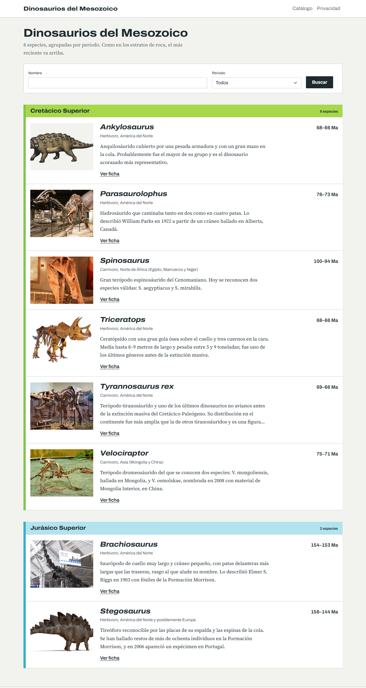
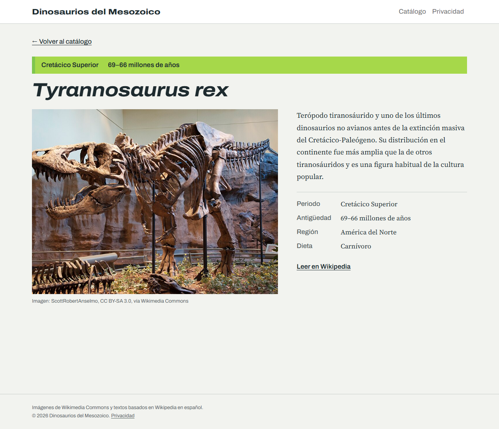
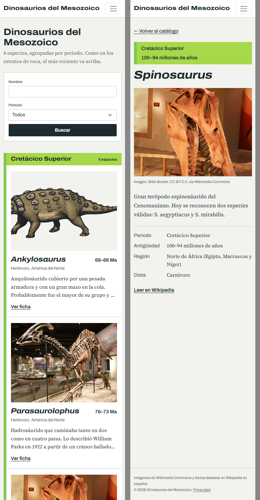

# 🦖 Web_Dinosaurios

Catálogo web de dinosaurios del Mesozoico construido con **ASP.NET Core MVC (.NET 8)**, **Dapper** y **SQLite**.

El objetivo real del proyecto es **aprender a orquestar varias IAs** con un stack conocido. El código de funcionalidad lo escribió DeepSeek, Claude Code lo revisó y diseñó la interfaz, y Agy documentó cada cambio en el Second Brain.



## Funcionalidades

- **Catálogo como columna estratigráfica:** las 8 especies se agrupan por periodo con los colores oficiales de la Carta Cronoestratigráfica Internacional (ICS); el estrato más reciente va arriba.
- **Búsqueda y filtro:** por nombre (`LIKE`) y por periodo (Jurásico o Cretácico, comparado por prefijo), en una sola consulta parametrizada con Dapper.
- **Ficha de cada especie:** periodo, antigüedad, región, dieta, descripción, imagen con su crédito y enlace a Wikipedia.
- **Base local:** `DatabaseInitializer` crea `App_Data/dinosaurios.db` con `Data/schema.sql` y la llena con `Data/seed.sql` la primera vez.
- **Diseño responsivo y accesible:** foco visible, `prefers-reduced-motion` y textos en español.

| Ficha | Móvil (375 px) |
|---|---|
|  |  |

## Roles de la orquestación

| Rol | Agente | Qué hace |
|---|---|---|
| Orquestador y diseñador | Claude Code | Divide objetivos en tareas (`planear`), aprueba o rechaza cada `git diff` y hace las vistas y el CSS (`disenar`) según `docs/guia-ui.md` |
| Desarrollador de funcionalidad | DeepSeek | Escribe modelos, repositorios, controladores y SQL en las tareas `implementar` |
| Especialista en documentación | Agy (Antigravity) | Procesa los handoffs y actualiza las notas del proyecto en el Second Brain |

Las tareas de diseño (`disenar`) detienen el orquestador: necesitan ver la app a varios anchos, así que Claude Code las hace en una sesión interactiva con la skill `frontend-design` (`.claude/skills/`).

### Ciclo de una tarea `implementar`

1. DeepSeek recibe la tarea y los archivos de `[archivos: ...]` y devuelve los archivos completos.
2. `dotnet build` verifica el resultado; si falla, DeepSeek corrige sin gastar una revisión de Claude.
3. Claude revisa el `git diff` junto con las guías de `docs/` que pida la tarea y responde APROBADO o RECHAZADO.
4. Si aprueba: commit `orquestador: ...`, la tarea pasa a `[x]` y se crea un handoff para Agy. Tras `MAX_REINTENTOS` rechazos queda en `[!]`.

El orquestador se detiene si hay cambios sin commit (para que una tarea fallida no contamine la siguiente) y si `dotnet run` bloquea los binarios.

## Estructura

```
Web_Dinosaurios/
├── orquestar.py                 # ciclo planear → implementar → revisar → documentar
├── tareas.md                    # cola de tareas (no se versiona)
├── .env.example                 # configuración del orquestador (copiar a .env)
├── .claude/skills/frontend-design/  # skill de diseño de Anthropic (Apache 2.0)
├── Controllers/DinosauriosController.cs  # Index (búsqueda) y Detalle
├── Models/Dinosaurio.cs
├── Repositories/                # IDinosaurioRepository y DinosaurioRepository (Dapper)
├── Data/                        # fábrica de conexiones, inicializador, schema.sql y seed.sql
├── Views/Dinosaurios/           # Index.cshtml y Detalle.cshtml
├── wwwroot/css/site.css         # tokens y estilos dino-* de la guía de UI
├── wwwroot/images/dinosaurios/  # imágenes de Wikimedia Commons
└── docs/
    ├── dinosaurios-semilla.md   # contrato de datos: esquema y 8 registros semilla
    ├── guia-ui.md               # contrato visual: tokens, tipografía y layout
    └── capturas/                # capturas del README
```

## Uso

Requisitos: SDK de .NET 8 o superior (el proyecto apunta a `net8.0`), Python 3, Claude Code con sesión iniciada y una clave de DeepSeek.

```powershell
dotnet run                      # http://localhost:5288

# Orquestador
pip install openai python-dotenv
copy .env.example .env          # y completar DEEPSEEK_API_KEY
python orquestar.py --dry-run   # ver las tareas pendientes sin llamar a ningún modelo
python orquestar.py --una       # procesar solo la siguiente tarea
```

Formato de `tareas.md`:

```
- [ ] (planear) Objetivo que Claude divide en tareas pequeñas
- [ ] (implementar) Tarea de funcionalidad para DeepSeek [archivos: ruta1, ruta2]
- [ ] (disenar) Cambio de vistas o CSS para Claude Code
- [ ] (documentar) Instrucción para Agy
```

> Cierra `dotnet run` antes de ejecutar el orquestador: en Windows la app abierta bloquea los binarios y el build falla.

Documentación del proyecto: `D:/Daniel/Obsidian/Data/00_Human/02_Second_Brain/Software/05_Projects/18_Web_Dinosaurios/Indice.md`

## Créditos

- **Imágenes:** Wikimedia Commons bajo licencias CC BY y CC BY-SA. El autor y la licencia de cada una están en `docs/dinosaurios-semilla.md` (campo `CreditoImagen`) y se muestran en la ficha.
- **Textos:** basados en los artículos de Wikipedia en español (consultados el 2026-10-26).
- **Skill `frontend-design`:** [anthropics/skills](https://github.com/anthropics/skills), licencia Apache 2.0.
